# Salvage Rights

*Beat them. Strip them. Bolt it on.*

You start with a crate on wheels and a remote control. Win a fight and the rulebook's salvage rights clause lets you unbolt a part from the wreck and keep it. Climb six leagues in six very different arenas, and your robot becomes a trophy case of everyone you beat, painted your way, until you are the champion.

**[▶ Play Salvage Rights](https://salvagerights.synapticnoise.com/)** in your browser. No install, works on desktop and on phones.

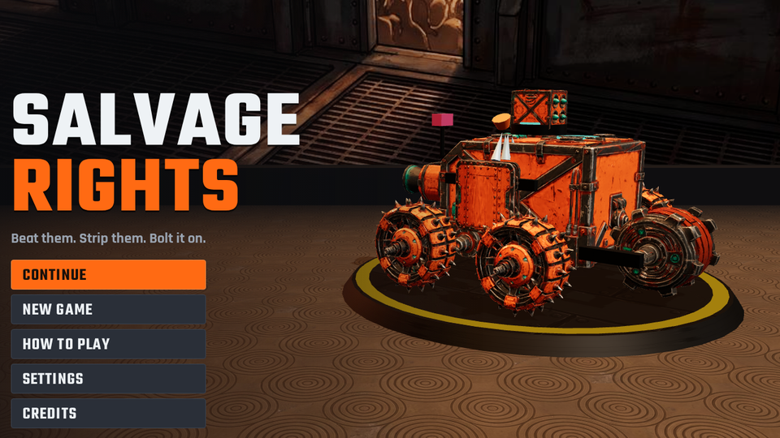

## The fights

Eighteen rivals, each built from the same kit of parts as you, so anything you see can end up on your robot. Three fights in each league, and the third is the league champion.

| | |
|---|---|
| 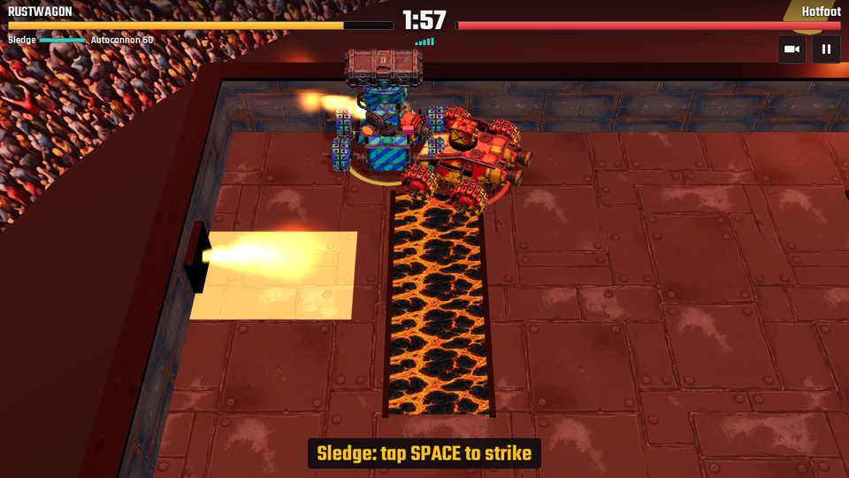 **The Crucible:** lava trenches and flame jets | 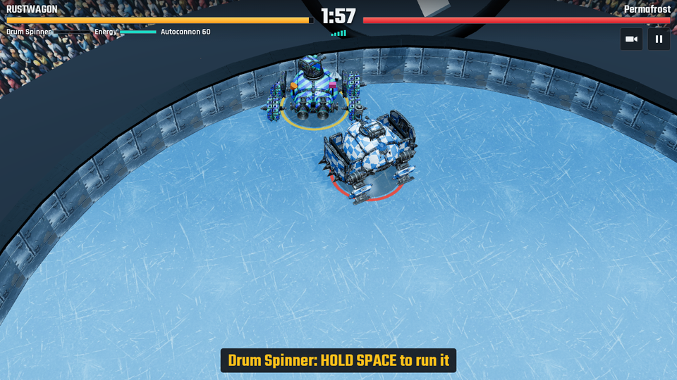 **The Deep Freeze:** an ice floor and crusher pistons |
| 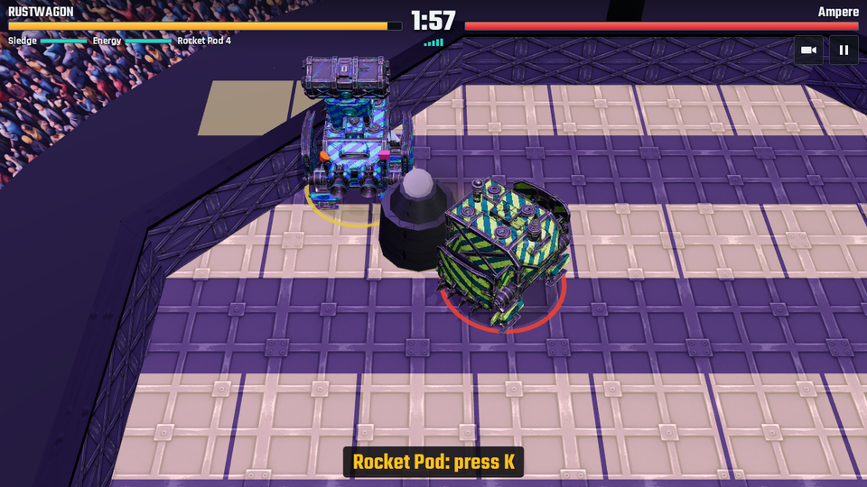 **The Arc Dome:** a floor that charges in warned patterns | 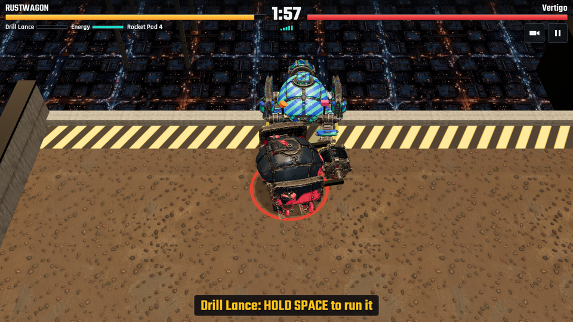 **The High Rise:** a rooftop with open sides and high winds |
| 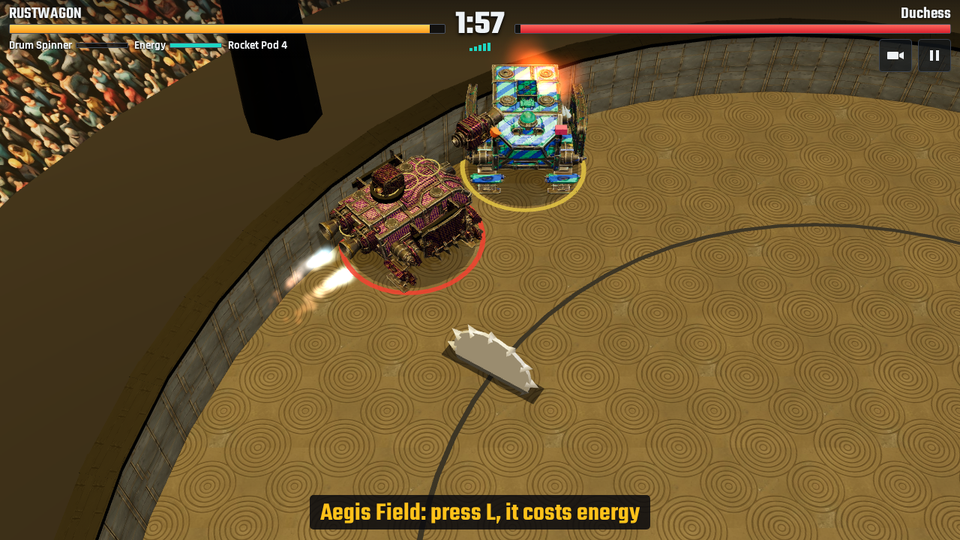 **The Sovereign Bowl:** floor saws, a giant swinging hammer and a pit | 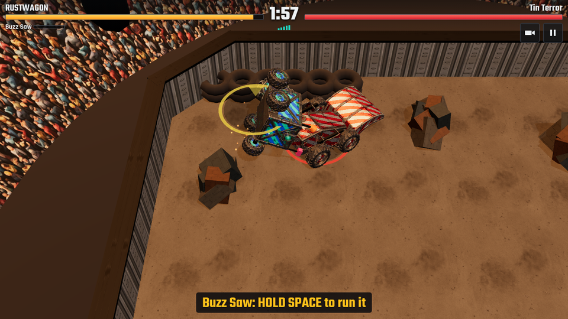 **The Scrap Pit:** where every driver starts |

## The garage

| | |
|---|---|
| 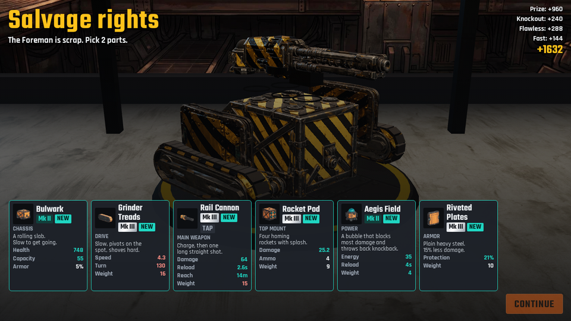 **Salvage:** take a part from every wreck | 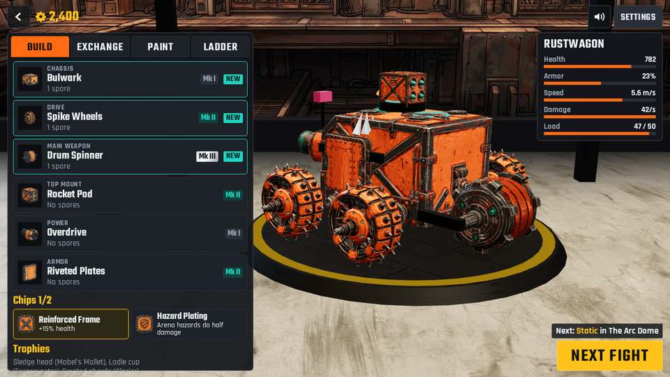 **Build:** chassis, drive, weapon, top mount, power, armor and chips |
| 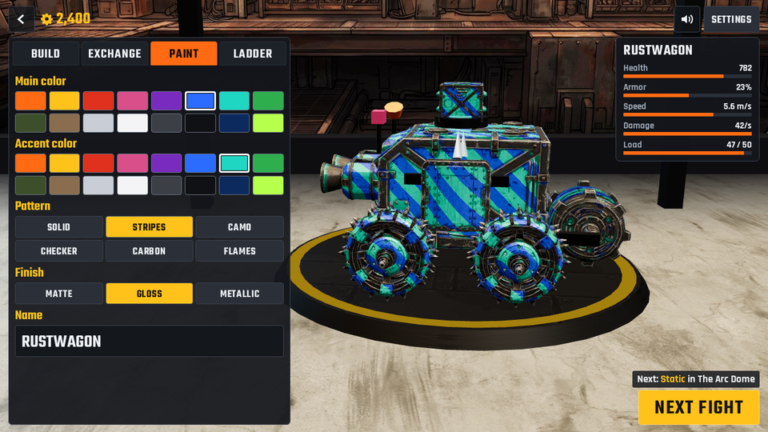 **Paint:** colors, patterns and finishes, on every part | 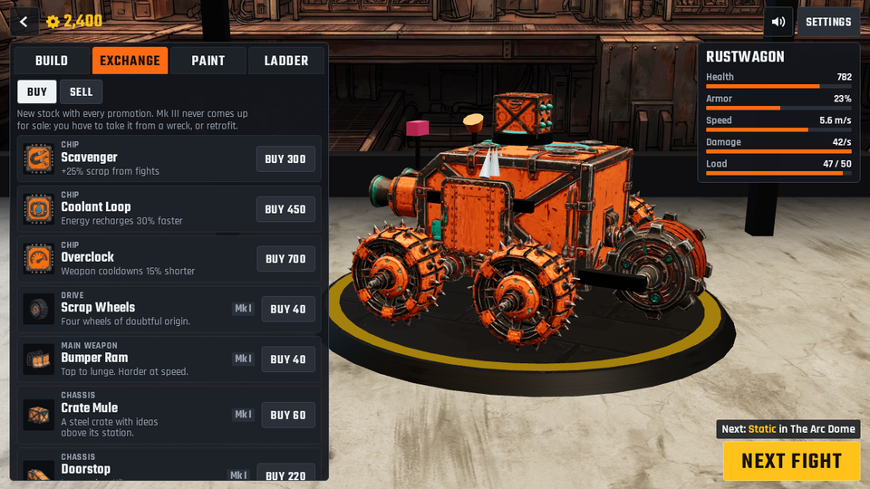 **Exchange:** buy, sell and retrofit |

Nine main weapons: Bumper Ram, Buzz Saw, Drum Spinner, Sledge, Lift Flipper, Drill Lance, Flame Projector, Arc Coil and Rail Cannon. Add rockets, mines or an autocannon up top, and a power like a shield, overdrive, an EMP, repair nanites or jump jets.

## How to play

You are in the driver's booth with a remote control. Your robot steers toward where you push and drives there.

- **Drive:** WASD or arrow keys
- **Main weapon:** Space or J. Tap or hold, depending on the weapon.
- **Top mount:** K, E or F
- **Power:** L or R
- **Lock on to the rival:** Q or Tab
- **Change camera:** C
- **Pause:** Esc or P. **Mute:** M.
- **Controller:** stick or d-pad to drive and move around menus, A main weapon and confirm, X top mount, B power and back, LB lock on, Y camera, Start pause.
- On a phone, hold it sideways and use the on-screen controls. You can install it from your browser's menu to play full screen, even offline.

Empty their health, knock them off the arena, or out-damage them by the horn. Hits to the rear do more. Losing costs nothing but pride: retry for free, and the sponsors chip in some scrap. Your garage and progress are saved in your browser.

## How it was made

Salvage Rights was made by [Claude Code](https://claude.com/claude-code) with [gamegen](https://github.com/zeveck/gamegen), from this request:

> A game in which you start with a simple robot and battle other robots in a battle arena, kinda like Battle Bots, but more elaborate robots. When you win you get to take a part from the other
> robot, which upgrades you. You go through a series of battles getting stronger and moving thorugh the ranks to be the battle champion. Between battles there's a "garage" or something where you can change
> out your parts/buffs. You can also sell/buy between things in the garage. There should be a variety of arenas. It should probably be a 3d game. You remote control during the fight. You can have cool
> weapons, powers, etc. You can also redesign/paint your robot. --budget 25 --3d --publish --no-confirm

gamegen designed the game, had review agents polish the design, made the art, music and sound with these plugins, built it, and play-tested it:

- [meshgen](https://github.com/zeveck/meshgen): the 28 robot parts as 3D models, which every robot is assembled from
- [nanogen](https://github.com/zeveck/nanogen): the concept picture behind each part, arena floors and walls, backdrops and driver portraits
- [imagegen2](https://github.com/zeveck/imagegen2): the buff chip icons and app icon
- [audiogen](https://github.com/zeveck/audiogen): the music, sound effects and arena announcer

The design, review logs, progress notes and recorded winning inputs for all 18 fights are in [`design/`](design/).

## Playing locally

Salvage Rights is a plain web page with no build step. Serve the `game` folder with any static web server, for example:

    cd game
    python3 -m http.server 8000

then open http://localhost:8000.

## Credits

An idea by Rich Conlan.

Fonts: Teko and Rajdhani, under the SIL Open Font License (bundled in `game/fonts`). Built on three.js, under the MIT License (`game/vendor`).
